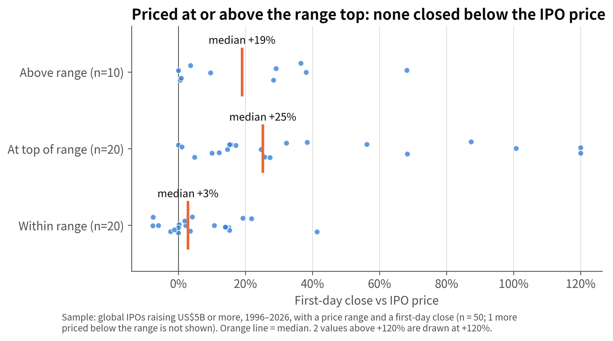
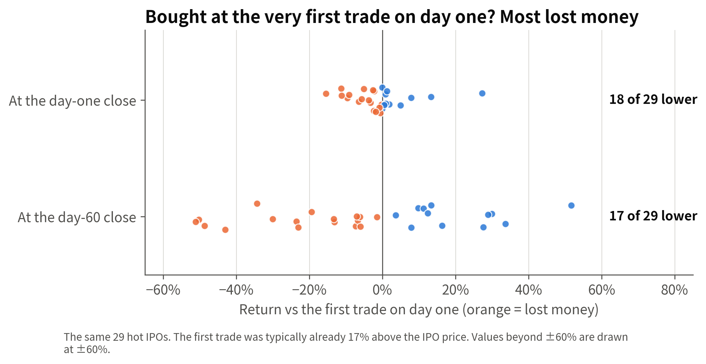
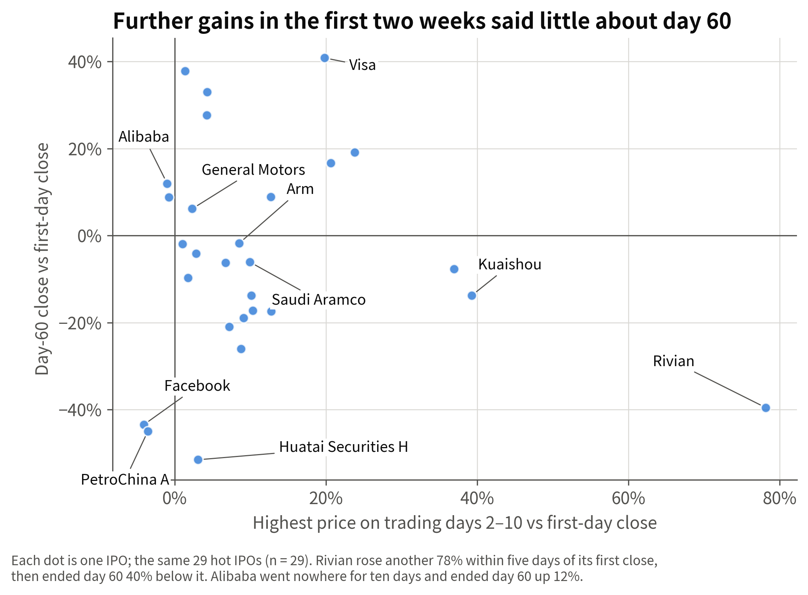
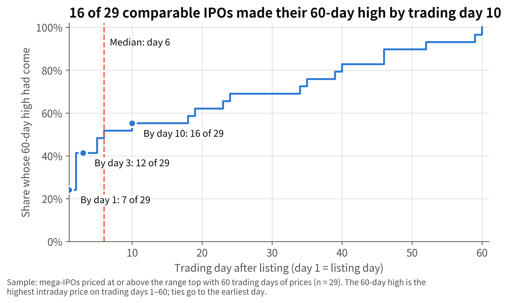
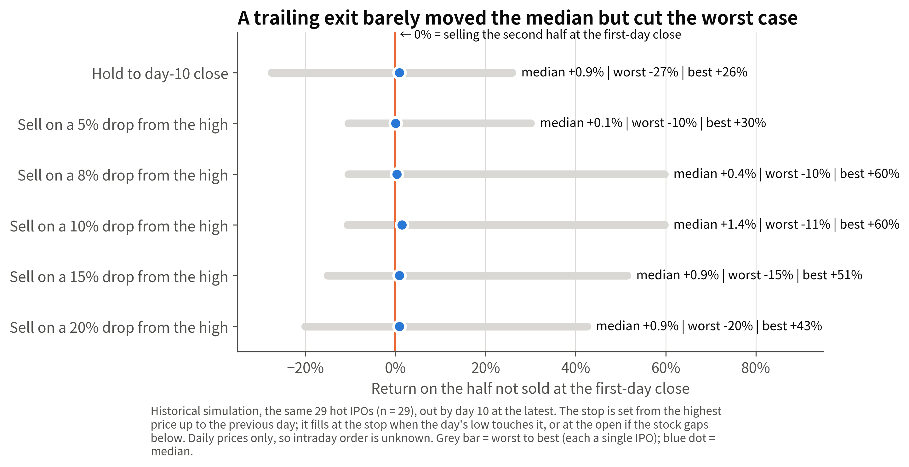

# Anthropic IPO: got shares? Selling all on day one is safest; to aim for more, sell within 10 days. Didn't? Don't chase it on day one.

We studied 60 of the biggest IPOs in history. All 30 that were priced the way Anthropic is expected to be priced closed their first day at or above the IPO price. But people who bought after trading started usually did not make money. Our forecast for Anthropic (stock ticker: ANT): if it is priced at $78 or more, as reports expect, a first-day rise of 15% to 25%; if it is priced lower, 0% to 10%.

Published before Anthropic sets its IPO price (expected Tuesday 2026-11-18) and starts trading on the Nasdaq stock exchange (expected Wednesday 2026-11-19), so anyone can check it afterwards.

## The answer in 30 seconds

**If you got shares at the IPO price:**
- History is on your side on day one. In all 30 similar IPOs, the stock closed day one at or above the IPO price.
- Our forecast: if the IPO price is $78 or more (as reports expect), ANT closes day one **15% to 25% above** it, most likely around 20%. If it is priced lower, 0% to 10%. This is a deliberately narrow call: in the past only about 1 in 8 similar IPOs landed exactly in this window.
- **The safest move:** sell everything at the end of day one. In all 30 similar IPOs, nobody who did this lost money.
- **To aim for more, what we would do:** sell half at the end of day one. Sell the rest if the price falls 10% from its highest point after day one, and in any case by day 10.
- Why not hold longer? In 18 of the 29 similar IPOs we could follow for three months, the price was lower on day 60 than at the end of day one.
- *You don't have to watch the market at night.* Many brokers let you set a "market-on-close" order, which sells at the closing price, and a "trailing stop" order, which sells automatically when the price falls a set percentage from its high. Check what your broker offers.

**If you did not get shares:**
- **Don't chase it on day one.** By the time ordinary investors can buy, most of the day-one gain has already happened: in similar IPOs the first trade was typically 17% above the IPO price.
- Even buying at that very first trade did not pay: in 18 of 29 cases the stock ended day one below it, and after three months it was lower in 17 of 29.

**The biggest risk to our forecast:** Anthropic lets employees and other insiders sell up to 316 million shares from day one. That is a lot of extra selling that the past IPOs mostly did not have.

The rest of this report explains, step by step, how we got there.

## Step 1: What is an IPO, and what is a "price range"?

An IPO (initial public offering) is the day a private company starts selling its shares to the public on a stock exchange. People who "get shares" in an IPO buy them at the IPO price before trading starts, usually by applying through their broker. Everyone else can only buy once the shares start trading.

Before IPO day, the company announces a **price range**: the lowest and highest price it expects to charge per share. For Anthropic it is **$70 to $78**. Big investors then say how many shares they want and at what price. If lots of people want in, the company sets the final IPO price at the top of the range, or even above it. If demand is weak, it lands lower.

Think of concert tickets. If a show sells out in minutes, resale prices jump the moment tickets hit the market. If seats are still available, they don't.

## Step 2: We studied the biggest IPOs in history

We collected 74 IPOs from 1996 to 2026 that each raised at least **US$5 billion**. For 60 of them we could verify the first-day closing price. They include Visa, Alibaba, Facebook, Arm, Saudi Aramco, Rivian and General Motors.

For each one we recorded the price range, the final IPO price, and how the share price moved over the next three months.

## Step 3: We sorted them into groups

We put each IPO into a group based on where its final price landed:

| Group | Day one, typical result | How many closed below the IPO price on day one |
|---|---|---|
| Priced **at the top** of the range (20 IPOs) | up about **25%** | **none** |
| Priced **above** the range (10 IPOs) | up about **19%** | **none** |
| Priced **inside** the range (20 IPOs) | up about **3%** | 1 in 4 |

When a company can price at the top, it means demand is strong. Strong demand usually shows up as a rise on day one. In the two "hot" groups, all 30 closed day one at or above the IPO price. Some only just: Facebook closed 0.6% up, and two closed exactly at the IPO price.

*Note:* three more IPOs priced at or above the top of their range, but we could not verify their first-day close. Innogy (2016) closed at its €36 IPO price, according to news reports. Enel (1999) was 0.5% above its IPO price in the afternoon of its first day (CNN); we did not find its closing price. Telstra (1997) was sold in instalments, and we did not find its closing price.

## Step 4: Which group is Anthropic in, and why 15% to 25%?

News reports say Anthropic's orders are already **several times** the number of shares on sale (Bloomberg: "multiple times"; the Hong Kong outlet BusinessFocus: about 5 to 6 times). The Financial Times reported that the banks are considering pricing **above** the range. Neither the demand figure nor the final price is official yet.

If that is right, Anthropic lands in the hot groups, where the typical first-day rise was 19% to 25%. Demand pulls the other way: among hot IPOs with reported demand of 3 to just under 10 times, similar to Anthropic's, the typical rise was about 13%, though there are only 6 of them. We give more weight to the pricing signal, which is based on 30 IPOs.

**So, if Anthropic prices at $78 or more, our forecast is +15% to +25% on day one, most likely around +20%. If it prices below $78, our forecast is 0% to +10%.** Past results in the hot groups ranged from flat to more than double, so this is a deliberately narrow call. We would rather be precise and possibly wrong than vague and certainly right.

## Step 5: Thinking of buying on day one because it looks hot? Read this first

When a big IPO is in the news, it is tempting to buy as soon as it starts trading. Most of the day-one jump happens before ordinary investors can buy. In the 29 hot IPOs we could follow for three months:

- The first trade was typically **17% above** the IPO price.
- If you bought at that first trade, the stock closed day one **lower in 18 of 29** cases (typical result −0.8%).
- If you held for three months, it was **lower in 17 of 29** cases (typical result −6%, worst −51%).

In other words, the people who made money on day one were the people who got shares at the IPO price. Chasing the stock on day one did not pay on average. If you did not get shares, the data says: don't chase it.

## Step 6: After day one, does it keep going up?

This is the question that matters if you are holding shares. We took the 29 hot-group IPOs we could follow for three months and split them in two:

- **Peaked early:** the highest price came on day one or soon after, then it drifted lower. Facebook is the famous example.
- **Kept rising:** the price went on climbing for days or weeks. Visa and Alibaba peaked around day 35 to 40.

Then we checked 14 possible clues, such as how much demand there was, how much the early owners sold, how fast the company was growing and how the first day went, to see if any of them could tell the two kinds apart in advance.

**None of the 14 clues worked reliably.** In the two weeks after day one, about half rose further (17 of 29 gained at least another 5%) and half did not, with no way to tell which in advance. By day 60, most (18 of 29) were below their first-day close. Rivian rose another 78% in five days and then fell 40%; Facebook only fell.

Here are the 14 clues, in everyday terms, for anyone curious:

| Clue | What it means | Why we thought it might matter |
|---|---|---|
| 1. Price above the range | How far the final price went above the range the company first announced | A big jump could mean huge demand, or that the price was already stretched |
| 2. Oversubscription | How many times more shares people asked for than were on sale | More eager buyers might keep buying after day one |
| 3. Extra shares added | Whether the company decided to sell more shares at the last minute | Selling more soaks up demand that could have pushed the price up later |
| 4. Selling by existing owners | How much of the sale came from early investors cashing out, rather than new shares from the company | If insiders are selling, maybe they think the price is high |
| 5. Retail share | How much of the IPO went to ordinary investors rather than big funds | Small investors may sell quickly, or chase the price higher |
| 6. Revenue growth | How fast the company's sales grew in the year before listing | Fast growers might attract more buyers over time |
| 7. Price-to-sales | The company's total value divided by its yearly sales: how "expensive" the stock is | Expensive stocks might have less room to rise |
| 8. Profit or loss | Whether the company made money in its last year | Loss-makers might be riskier, or more exciting |
| 9. Market mood | How the overall stock market did in the three months before the IPO | A rising market might lift everything |
| 10. Market jumpiness | How much the overall market was swinging up and down just before the IPO | Nervous markets might sell new stocks faster |
| 11. Day-one gain | How much the stock rose on its first day | A huge first day might mean the good news is already used up |
| 12. Where day one closed | Whether the stock ended day one near its high or near its low for the day | Closing near the low might show buyers running out |
| 13. Day-one close vs open | Whether the stock ended day one above or below where it started trading | A fade during the day might be an early warning |
| 14. Day-one trading volume | How many shares changed hands on day one, compared with the number sold in the IPO | Heavy trading might mean lots of people taking quick profits |

Some looked slightly promising (for example, loss-making companies kept rising a bit more often), but the groups were too small for the pattern to be trusted.

## Step 7: When does the high usually come?

Out of the 29:

- 7 hit their three-month high **on day one**.
- 16 hit it **within the first two weeks** (10 trading days).
- Half had peaked by **day 6**.

The high often comes early, but usually not on day one. Selling everything on day one can leave money on the table, while holding for months is a gamble.

## Step 8: If you got shares, how to sell in stages

Because you cannot know in advance which kind ANT will be, we tested simple rules that work either way. This one did well:

1. **Sell half at the close of day one.** This locks in the day-one gain on half your shares.
2. **For the other half, use a 10% "drop from the top" rule.** Start from the day-one closing price and keep track of the highest price after that. If the price falls 10% below that high, sell.
3. **Sell whatever is left at the close of day 10** (two weeks of trading).

*Example:* you got 10 shares at $78 and day one closes at $94. You sell 5 at $94. The other 5 climb to $110 on day 4, then slip. You sell them when the price falls 10% from $110, at about $99. If it never falls that far, you sell at the day-10 close.

How did this do across the 29 past IPOs? Compared with selling everything on day one, the typical (median) result for the second half was about the same, slightly better at +1.4%. Compared with simply holding the second half to day 10, the rule cut the worst case from a loss of **27%** to a loss of about **11%** (both measured from the day-one close), and still kept the best case (Rivian, about **+60%**). One limit: the rule cannot protect you if the price drops sharply overnight; across all 57 IPOs we tested, the worst such case lost 19%.

*You don't have to watch the market at night.* Many brokers let you set a "market-on-close" order, which sells at the closing price, and a "trailing stop" order, which sells automatically when the price falls a set percentage from its high. Check what your broker offers.

This is what the historical numbers show, not a promise and not personal investment advice.

## Step 9: Two things that make Anthropic different

History is a guide, but Anthropic is unusual in two ways:

1. **Insiders can sell from day one.** In the big IPOs where we checked the terms, insiders were locked in for months: 180 days at Visa, Arm, Rivian and General Motors, and 91 days for Facebook's earliest unlock. Anthropic's filing lets staff, officers and consultants sell up to **316 million shares from the first day**. That is 38% on top of the 825 million shares being offered. More becomes sellable around December 15, and about 1.6 billion shares in total by early February 2027. More sellers can hold the price back.
2. **It is growing faster than anything in our data.** Anthropic's revenue grew about **1,088%** in 2025. Among the 26 IPOs in our data with revenue figures, the fastest grew 93%.

The extra sellers could push ANT's day-one rise toward the lower end of our range, or below it. The fast growth could cut either way: it may excite buyers, or make the price harder to judge. If we miss, these are the most likely reasons.

| | ANT | Facebook 2012 | Typical similar IPO |
|---|---|---|---|
| Shares sold by existing owners | 2.9% | 57% | 0% |
| Revenue growth, last full year | +1,088% | +88% | +22% |
| Price-to-sales at the top of the range | about 29x | 28x | 5.2x |
| Shares insiders may sell from day one | up to 316 million (38% of the 825 million offered) | none for 91 days | Cerebras: about 8% of shares offered; Visa, Arm, Rivian, GM: none for 180 days; others not checked |

## Step 10: A cautionary tale, Facebook 2012

Facebook closed its first day just 0.6% above its $38 IPO price, then fell 43% over the next three months. A lot went wrong at once:

- It raised its price range during the sales roadshow, then sold 25% more shares, all from existing owners. In total, existing owners sold 57% of the shares on offer.
- During the roadshow it warned that users were moving to mobile faster than ads could follow. Its lead bank's analyst cut his sales forecasts, and big clients were told (Reuters). Massachusetts later fined Morgan Stanley US$5 million.
- Nasdaq's systems failed at the open. The SEC later fined Nasdaq US$10 million.
- The banks bought shares to stop the price falling below $38 (Bloomberg; Federal Reserve Bank of New York).

General Motors in 2010 did several of the same things and was still up 6% after three months. No single warning sign predicts a flop, which is why the selling rule in Step 8 is useful.

## Step 11: What the betting markets say

On Polymarket, a website where people bet on outcomes (snapshot 2026-11-16 01:24 UTC), traders gave a **90% chance** that ANT closes its first day above its IPO price. Their most likely range for ANT's first-day value works out to a closing price of about $95 to $115 a share, by our own conversion: a rise of 22% to 47% if the IPO price is $78, or 6% to 27% if it is $90. A pre-listing contract on the crypto exchange Hyperliquid implied a much higher value, about US$2.1 trillion, which we treat as an outlier.

The betting markets also expect a gain on day one. At a $90 IPO price their most likely range overlaps ours; at $78 it sits above ours.

## For people who want to check our work

### The predictions, exactly

| # | Prediction | Share of similar past IPOs that landed in this range (the same IPOs we used to choose it) |
|---|---|---|
| 1 | If the final IPO price is **$78.00 or higher**: first-day return **+15% to +25%** (central estimate +20%) | 4 of 30 (13%) |
| 2 | If the final IPO price is **below $78.00**: first-day return **0% to +10%** | 7 of 20 (35%) |
| 3 | The highest price of ANT's first 60 trading days comes **on or before trading day 10** | 16 of 29 (55%) |

These are deliberately narrow windows around our central estimates, not statistical confidence intervals: in the past only about one in eight similar IPOs landed inside +15% to +25%. A wider window (+10% to +40%) would have covered about half of them (14 of 30), but would say much less. The +20% does not adjust for the two ANT-specific risks in Step 9; if they matter, expect the lower half of the range or below.

### How we will score it (fixed before pricing)

1. **R** = (Nasdaq Official Closing Price of ANT's Class A common stock on its first day of regular trading, or the last regular-session trade if no Official Closing Price is published ÷ final IPO price in the final prospectus filed under SEC Rule 424(b), normally a 424B4) − 1, unrounded.
2. If the final IPO price is $78.00 or higher: #1 is a hit if +15% ≤ R ≤ +25%. #2 is not scored.
3. If the final IPO price is below $78.00: #2 is a hit if 0% ≤ R ≤ +10%. #1 is not scored.
4. #3: day 1 is ANT's first day of regular trading, and trading days are days on which ANT trades on Nasdaq. The 60-day high is the highest intraday price on trading days 1–60, as published by Nasdaq (or Yahoo Finance if Nasdaq's history is unavailable); ties go to the earliest day. Hit if that day is on or before trading day 10. Trading day 60 falls around 2027-02-17. If ANT trades for fewer than 60 days (for example, a halt or delisting), #3 is void.
5. Outside a range is a miss. There is no partial credit.
6. If ANT has not started trading on Nasdaq by 2026-12-31, or lists without an IPO price (for example, a direct listing), all predictions are void.

We will post the day-one result on 2026-11-19 and the peak-timing result after trading day 60. The predictions are locked; later news does not change them.

### Caveats

- These are patterns from a small, global sample, not a model of Anthropic's business.
- 13 of the 29 IPOs used for peak timing are listings in Shanghai or Hong Kong (2000–2021), different markets from today's Nasdaq.
- Demand figures for ANT come from news reports. US banks do not publish official order numbers.
- One IPO is one result. Getting it right would not prove the method, and getting it wrong would not disprove it.
- This is a statistical forecast, not personal investment advice.

### Statistical details

- Sample: 74 IPOs raising US$5 billion or more, 1996–2026; 60 with a verified first-day close. Median first-day return +14.1%. 51 had a price range, using the hand-checked `pricing_group` column: 20 priced at the top, 10 above, 20 inside, 1 below. Medians: top +25.2%, above +19.0%, inside +2.9% (25% closed below the IPO price). Listings that set only a maximum price (for example CATL's 2025 Hong Kong listing) are not counted as having a range. Three more priced at or above the top but have no verified first-day close in our data (Enel 1999, Innogy 2016, Telstra 1997; see Step 3).
- Oversubscription vs first-day return: Spearman ρ = +0.57, n = 45, p < 0.001. Medians by reported coverage: under 3x 0% (n = 10); 3–6x +12% (n = 8); 6–10x +2% (n = 3); over 10x +26% (n = 24). Reports of "more than 10 times" are counted in the over-10x group.
- Deal size and profitability showed no detectable link to the first-day return.
- After day one: we tested the 14 features in Step 6 against two outcomes (the highest price on days 2–10, and the day-60 close, both against the first close), in two samples: the 29 IPOs priced at or above the top of the range, and all 57 IPOs with 60 days of prices. In the 29, the smallest p-value was 0.07 (smallest Benjamini–Hochberg q = 0.61). In the 57, the smallest was 0.010 (profitable vs loss-making companies, days 2–10), q = 0.29. Nothing survived correction. Sample sizes per test range from 18 to 57 because some features are missing for some IPOs. With samples this small only a strong effect would show, so this does not prove no signal exists. Full results: `data/feature_tests.csv` (`code/feature_tests.py`).
- First two weeks vs day 60: Spearman ρ = +0.06 between the days 2–10 high and the day-60 close (n = 29, p = 0.75).
- Day-one give-back: IPOs up 20% or more on day one (n = 20) had a median day-60 return of −13.4% from their first close, against −1.0% for the other 36 (the 56 IPOs with 60 days of prices and a verified first-day return); Mann-Whitney p = 0.14. Of the 29, 11 were above their first close at day 60 (median −6.1%), and 17 rose at least 5% more within days 2–10 (`code/day_one_giveback.py`).
- Buying after listing (`code/buy_after_listing.py`, 29 IPOs): the first trade was a median +17.3% above the IPO price. Bought at the first trade: day-one close median −0.8% (18 of 29 lower; best moment of the day median +3.3% above the first trade); day-10 close +0.6% (14 lower); day-60 close −6.1% (17 lower, worst −51%). Bought at the day-one close: day-10 close +0.9% (13 lower); day-60 close −6.1% (18 lower).
- Exit simulation: 29 IPOs, half sold at the first-day close, the rest out by day 10. Only a 50/50 split was tested. Fixed-day medians: day 3 −0.8%, day 10 +0.9%. Trailing exits at 5%, 8%, 10%, 15% and 20% had medians of +0.1% to +1.4% and worst cases of about −10% to −20% (holding to day 10: −27%). 8% and 10% looked best in this sample, but with 29 IPOs the difference is not meaningful. The stop is set from the highest daily high up to the previous day and fills at the stop price, or at the open if the stock opens below it. Daily data cannot show intraday order. A stop cannot help when the price gaps below it overnight: across all 57 IPOs, the worst result with the 10% rule was −19% (China Telecom A, a gap down on day 3).
- Hot IPOs with reported demand of 3 to just under 10 times (similar to ANT): n = 6, median first-day return +12.6%.
- Peak timing without Shanghai A-shares: 13 of 24 by day 10, median day 8. Without all 13 Shanghai and Hong Kong listings: 10 of 16, median day 2. US listings only: 5 of 9 by day 10, median day 5.
- Polymarket share counts (our assumptions for converting market values to per-share prices; Polymarket's own rules decide settlement): "IPO valuation" taken as about 18.0 billion fully diluted shares (US$1.50–1.75 trillion, about $83–97 per share, 53%; US$1.25–1.50 trillion, about $69–83, 46%). "Closing market cap" taken as about 13.09 billion shares of all classes (US$1.25–1.50 trillion, 44%). "How much will Anthropic's stock move on IPO day?" had traded only about US$1,000 and was not used. Hyperliquid's implied value of about US$2.1 trillion is from 2026-11-14.
- Insider releases from the S-1/A: up to 316 million shares from day 1; up to 299 million around 2026-12-15 (about trading day 18); about 1.6 billion in total by early February 2027 (about day 50); up to 1.7 billion more from the second trading day after the first full-year earnings release.

### Disclosure

The author has no affiliation with Anthropic, its underwriters or Polymarket. AI tools were used to write analysis code and to review drafts. Every statistic computed from our data can be re-run from `code/` and `data/`. Outside facts (Anthropic's filing, news reports, Polymarket and lockup terms) are linked in the references. The deal features in `data/merged_features.csv` were collected by hand from prospectuses, allotment announcements and company filings; everything computed from them re-runs.

### Data and code

Run any script from the repository root with `python3 code/<file>.py` (Python 3.10+, pandas, numpy, scipy, matplotlib). Some column names in the data files are in Chinese.

| File | What it does |
|---|---|
| `data/mega_ipos.csv` | The mega-IPO list, with a source URL for each row. `first_close_from_offer_pct` is the checked first-day return (adjusted for share splits and currencies) |
| `data/daily_prices_first70.csv` | Daily prices for the first 70 trading days of each IPO, adjusted back to the IPO share basis |
| `code/first_day_by_pricing.py` | First-day return by where the IPO priced in its range |
| `code/features_vs_returns.py` | Oversubscription, pricing and profitability against first-day return |
| `code/peak_timing.py` | Trading day of the 60-day high |
| `code/exit_trailing_sim.py`, `code/exit_fixed_day.py` | Exit simulations |
| `code/day_one_giveback.py` | Day-one winners vs the rest at day 60; how many were above their first close at day 60 |
| `code/buy_after_listing.py` | What happened to people who bought on the market after trading started |
| `code/make_figures.py` | The five figures (`LANG_FIG=zh` for the Chinese versions) |
| `code/polymarket_conversion.py` | Converts Polymarket valuation brackets to per-share prices |
| `code/feature_tests.py` → `data/feature_tests.csv` | The 14 feature tests (input: `data/merged_features.csv`) |
| `data/price_features.csv`, `data/exit_trailing_sim.csv`, `data/exit_fixed_day.csv`, `data/features_vs_returns.csv` | Intermediate results |

A Chinese version of this report is in `報告.md`.

### References

- Anthropic S-1/A, 2026-11-10: https://www.sec.gov/Archives/edgar/data/2130357/000162828026072484/anthropicpbc-sx1ax2.htm
- Bloomberg, 2026-11-11, Anthropic's IPO said to be multiple times oversubscribed: https://www.bloomberg.com/news/articles/2026-11-11/anthropic-s-mega-ipo-is-said-to-be-multiple-times-oversubscribed
- BusinessFocus (Hong Kong), 2026-11-13, order book about 5 to 6 times covered (seen as a screenshot; we do not have a link)
- Financial Times, mid-November 2026 (pricing above the range under consideration): https://www.ft.com/content/68bcba57-0575-44ee-80f4-2e5ea23a431e
- CNBC, 2026-11-10, price range set at $70 to $78: https://www.cnbc.com/2026/11/10/anthropic-sets-price-range-of-70-to-78-in-upcoming-ipo.html
- Polymarket: https://polymarket.com/event/anthropic-ipo-closing-price-above-ipo-price-on-first-day, https://polymarket.com/event/what-will-anthropics-ipo-valuation-be, https://polymarket.com/event/anthropic-ipo-closing-market-cap-higher-strikes, https://polymarket.com/event/how-much-will-anthropics-stock-move-on-ipo-day
- Pre-IPO perpetual market data (Talos dashboard): https://www.talos.com/dashboards/pre-ipo-perps-market-data
- SEC order against Nasdaq over the Facebook IPO, Release No. 34-69655, 2013-05-29: https://www.sec.gov/files/litigation/admin/2013/34-69655.pdf
- Massachusetts Securities Division consent order with Morgan Stanley, Docket 2012-0042, 2012-12-17: https://www.sec.state.ma.us/divisions/securities/pdf-html/docket_no_2012-0042.htm
- Reuters via Daily Maverick, 2012-05-22, Morgan Stanley cut Facebook estimates during the roadshow: https://www.dailymaverick.co.za/article/2012-05-22-morgan-stanley-cut-facebook-estimates-just-before-ipo/
- Bloomberg, 2012-05-19, Morgan Stanley props up Facebook's price: https://www.bloomberg.com/news/articles/2012-05-19/facebook-banker-morgan-stanley-props-up-price-it-helped-boost
- Federal Reserve Bank of New York, Liberty Street Economics, 2012-10-31, underwriters' stabilization in the Facebook IPO: https://libertystreeteconomics.newyorkfed.org/2012/10/in-a-relationship-underwriters-efforts-to-stabilize-the-share-price-in-the-facebook-ipo.html
