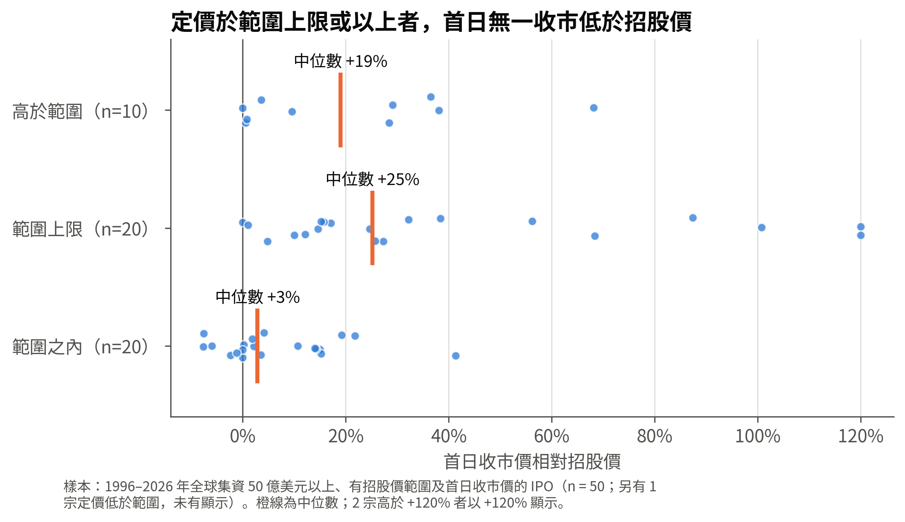
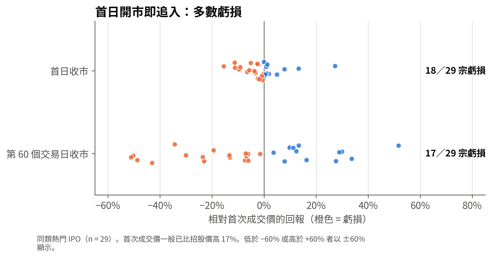
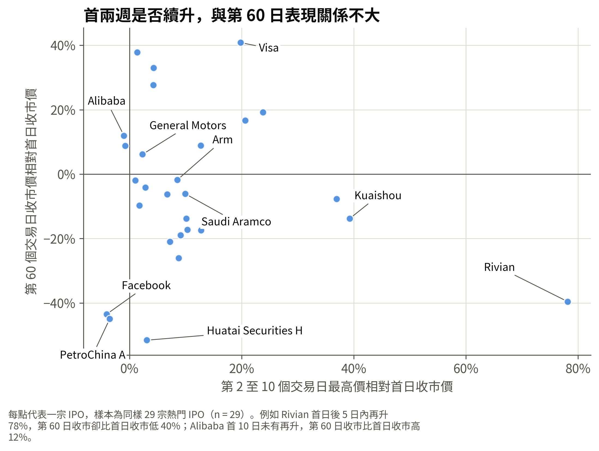
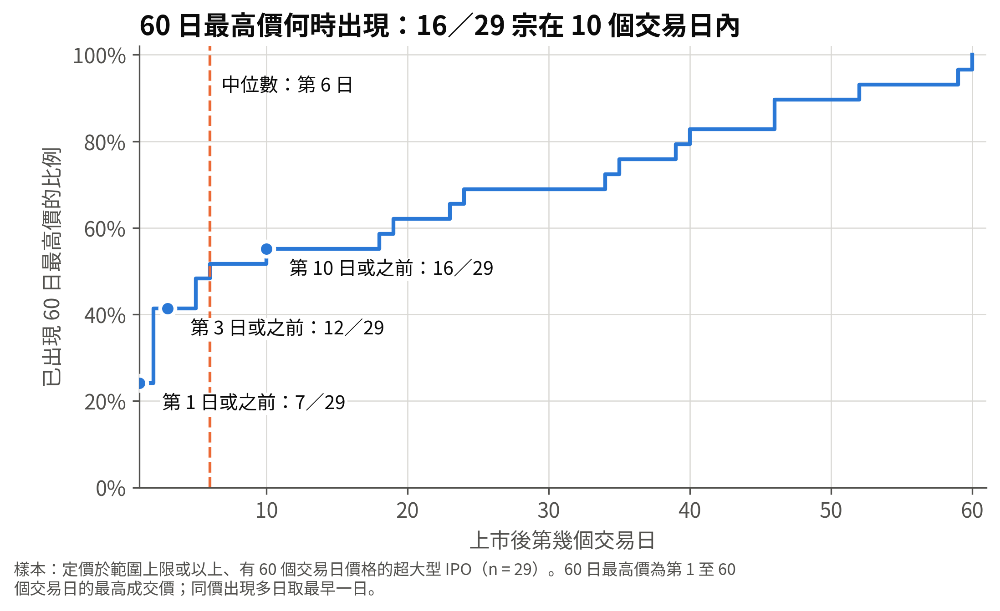
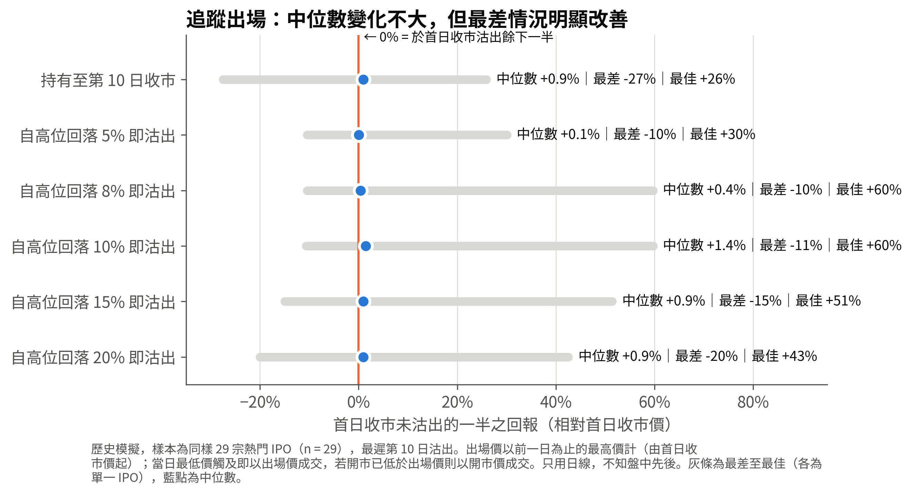

# Anthropic 上市：抽中了？首日全沽最穩妥，想多賺就最遲 10 日內沽清。抽不中？首日別追

我們研究了史上 60 宗最大型的 IPO。其中定價方式與 Anthropic 預期相同的 30 宗，首日收市全部持平或高於招股價；但在開始交易後才買入的人，通常沒有賺錢。我們對 Anthropic（股票代號 ANT，並非螞蟻集團）的預測是：首日上升 15% 至 25%。

本文於 Anthropic 定價（預計美國時間 2026-11-18 星期二）及在 Nasdaq 交易所開始交易（預計美國時間 2026-11-19 星期三）之前發表，任何人事後都可以核對。Nasdaq 收市時間約為香港及台灣時間翌日清晨 5 時。

## 30 秒答案

**如果你以招股價抽中了股份：**
- 首日歷史對你有利：30 宗同類 IPO 首日收市全部持平或高於招股價。
- 我們的預測：ANT 首日收市比招股價高 **15% 至 25%**，最可能約 20%。這是刻意收窄的預測：過往同類 IPO 只有約八分之一剛好落在這個範圍。
- **最穩妥的做法：** 首日收市全部沽出（即賣出）。30 宗同類 IPO 中，這樣做沒有一宗虧本。
- **想多賺一點，我們會這樣做：** 首日收市沽出一半；餘下的，若股價由首日之後的最高位回落 10% 便沽出，無論如何最遲第 10 個交易日沽清。
- 為何不長期持有？在可追蹤三個月的 29 宗同類 IPO 中，有 18 宗在第 60 日的股價低於首日收市價。
- *不必半夜看盤。* 不少券商提供「收市價買賣盤」（market-on-close，以收市價沽出）及「追蹤止損盤」（trailing stop，股價由高位回落指定百分比時自動沽出），可預先設定。請查看你的券商是否提供。

**如果你抽不中：**
- **首日不要追。** 一般投資者能買入時，大部分首日升幅已經發生：同類 IPO 的首次成交價，一般已比招股價高 17%。
- 即使在首次成交那一刻買入，29 宗之中有 18 宗首日收市低於買入價；三個月後，則有 17 宗低於買入價。整體而言，首日追入並不划算。

**預測的最大風險：** Anthropic 容許員工及其他內部人士由首日起出售最多 3.16 億股。過往的 IPO 大多沒有這麼多額外賣盤。

以下逐步說明我們怎樣得出這些結論。

## 第一步：甚麼是 IPO？甚麼是「招股價範圍」？

IPO 即首次公開招股，是一家私人公司第一次在交易所向公眾出售股份。所謂「抽中」，是指在開始交易之前，透過券商申請並以招股價買到股份；其他人只能在股份開始交易後才買入。

上市之前，公司會先公佈 **招股價範圍**，即預計每股最低和最高的售價。Anthropic 的範圍是 **每股 70 至 78 美元**。大型投資者隨後表明想買多少股、願意出甚麼價。如果想買的人很多，公司就會把最終招股價定在範圍上限，甚至高於範圍；如果需求疲弱，價格就會定得較低。

可以把它想像成演唱會門票：若門票幾分鐘內售罄，轉售價一開賣就會上升；若仍有很多空位，轉售價就不會升。

## 第二步：我們研究了史上最大型的 IPO

我們搜集了 1996 至 2026 年間每宗集資最少 **50 億美元** 的 IPO，共 74 宗，其中 60 宗的首日收市價可以核實，包括 Visa、Alibaba、Facebook、Arm、Saudi Aramco、Rivian 和通用汽車。

每一宗我們都記錄了招股價範圍、最終招股價，以及其後三個月的股價走勢。

## 第三步：把它們分組

我們按最終招股價落在範圍的哪個位置，把每宗 IPO 分組：

| 組別 | 首日一般表現 | 首日收市低於招股價的比例 |
|---|---|---|
| 定價於範圍 **上限**（20 宗） | 升約 **25%** | **沒有** |
| 定價 **高於** 範圍（10 宗） | 升約 **19%** | **沒有** |
| 定價於範圍 **之內**（20 宗） | 升約 **3%** | 四分之一 |

公司能把價格定在上限，代表需求強勁，而強勁的需求通常會在首日反映為股價上升。在這兩個「熱門」組別中，30 宗首日收市全部持平或高於招股價。部分只是勉強做到：Facebook 只升 0.6%，另有兩宗剛好以招股價收市。

*註：* 另有三宗 IPO 定價於範圍上限或以上，但我們未能核實其首日收市價。Innogy（2016 年）據新聞報道以 36 歐元招股價收市；Enel（1999 年）上市首日下午比招股價高 0.5%（CNN），收市價未能找到；Telstra（1997 年）以分期付款方式發售，收市價未能找到。

## 第四步：Anthropic 屬於哪一組？為何是 15% 至 25%？

新聞報道指 Anthropic 收到的認購已是可分配股份的 **數倍**（Bloomberg：「數倍」；香港媒體 BusinessFocus：約 5 至 6 倍）。《金融時報》報道承銷銀行正考慮把價格定得 **高於** 範圍。認購數字和最終價格目前均非官方數字。

若報道屬實，Anthropic 便屬於熱門組別，這些組別首日一般升 19% 至 25%。認購數據則指向較低：熱門組別中認購倍數與 Anthropic 相近（3 倍至不足 10 倍）的 IPO，首日一般升約 13%，但只有 6 宗。我們較重視以 30 宗為基礎的定價訊號。

**因此，我們預測 ANT 首日升 15% 至 25%，最可能約 20%。** 熱門組別過往的結果由持平到翻倍以上都有，所以這是一個刻意收窄的預測。我們寧願說得精準而可能猜錯，也不願說得含糊而必定猜中。

## 第五步：看見大熱，想首日搶購？先看這一段

大型 IPO 成為新聞焦點時，很多人會想一開市就買。然而大部分首日升幅，在一般投資者能買入之前已經發生。在可追蹤三個月的 29 宗熱門 IPO 中：

- 首次成交價一般已比招股價 **高 17%**。
- 若在首次成交時買入，有 **18 宗** 首日收市低於買入價（中位數 −0.8%）。
- 若持有三個月，有 **17 宗** 低於買入價（中位數 −6%，最差 −51%）。

換言之，首日賺錢的，是以招股價抽中股份的人；首日追入的人，整體而言並沒有賺到。抽不中的話，數據的答案是：不要追。

## 第六步：首日之後，股價會繼續升嗎？

如果你手上持有股份，這才是關鍵問題。我們把可追蹤三個月的 29 宗熱門 IPO 分成兩類：

- **早見頂：** 最高價出現在首日或之後不久，然後逐步下滑。最著名的例子是 Facebook。
- **繼續升：** 股價在其後數日甚至數星期持續上升。Visa 和 Alibaba 約在第 35 至 40 日才見頂。

然後我們檢查了 14 條可能的線索，例如認購有多踴躍、早期股東賣了多少、公司增長有多快、首日表現如何，看看有沒有一條能事先分辨這兩類。

**14 條線索沒有一條可靠。** 首日之後兩星期內，約一半繼續上升（29 宗中 17 宗再升最少 5%），另一半沒有，而且無法事先分辨；到第 60 日，大部分（29 宗中 18 宗）已低於首日收市價。Rivian 五日內再升 78%，之後卻下跌 40%；Facebook 則一直下跌。

以下是 14 條線索的白話解釋，供有興趣的讀者參考：

| 線索 | 意思 | 我們為何以為它可能有用 |
|---|---|---|
| 1. 高於範圍的幅度 | 最終價格比公司最初公佈的範圍高出多少 | 大幅提價可能代表需求極大，也可能代表價格已經偏高 |
| 2. 超額認購 | 想買的股數是可分配股數的多少倍 | 渴望買入的人越多，首日之後可能仍會繼續買 |
| 3. 臨時增加股數 | 公司有否在最後關頭決定多賣股份 | 多賣股份會吸走原本可能在日後推高股價的需求 |
| 4. 舊股東出售比例 | 這次發售有多少來自早期投資者套現，而不是公司發行的新股 | 內部人士賣股，可能代表他們覺得價格偏高 |
| 5. 散戶比例 | 有多少股份分配給一般投資者，而不是大型基金 | 散戶可能很快沽出，也可能追高 |
| 6. 營收增長 | 公司上市前一年的銷售額增長有多快 | 增長快的公司可能隨時間吸引更多買家 |
| 7. 市銷率 | 公司總市值除以全年銷售額，即股票有多「貴」 | 越貴的股票，上升空間可能越小 |
| 8. 盈利或虧損 | 公司最近一年有沒有賺錢 | 虧損的公司可能風險較高，也可能更具話題 |
| 9. 大市氣氛 | 上市前三個月整體股市的表現 | 大市上升可能帶動所有股票 |
| 10. 大市波動 | 上市前一段時間整體股市的波動有多大 | 市場緊張時，新股可能較快被沽出 |
| 11. 首日升幅 | 股票首日升了多少 | 首日升得太多，可能代表好消息已經用盡 |
| 12. 首日收市位置 | 首日收市價接近當日高位還是低位 | 收市接近低位，可能代表買家開始退場 |
| 13. 首日收市對開市 | 首日收市價高於還是低於開市價 | 開高收低可能是早期警號 |
| 14. 首日成交量 | 首日成交了多少股，相對於這次發售的股數 | 成交量大，可能代表很多人急於獲利 |

部分線索看似有點苗頭（例如虧損公司其後繼續上升的情況略多），但組別太小，這種規律不足為信。

## 第七步：最高價通常何時出現？

在 29 宗之中：

- 7 宗在 **首日** 出現三個月內的最高價。
- 16 宗在 **首兩星期內**（10 個交易日）出現。
- 一半在 **第 6 日或之前** 已見頂。

最高價通常來得早，但多數不是首日。因此首日全部沽出可能會少賺，持有數月則是賭博。

## 第八步：抽中了，怎樣分段沽出

既然無法事先知道 ANT 屬於哪一類，我們測試了一些無論哪一類都適用的簡單規則。以下這條表現不錯：

1. **首日收市時沽出一半。** 這樣可以確保一半股份賺到首日升幅。
2. **餘下一半，採用「由高位回落 10%」的規則。** 由首日收市價開始，記住其後出現的最高價；若股價跌到比這個高位低 10%，便沽出。
3. **第 10 個交易日（約兩星期）收市時，沽出所有剩餘股份。**

*例子：* 你以 78 美元抽中 10 股，首日收市 94 美元，於 94 美元沽出 5 股。餘下 5 股在第 4 日升至 110 美元後回落，當股價由 110 美元回落 10%，即約 99 美元時沽出。若一直沒有回落這麼多，便於第 10 日收市沽出。

這個方法在過往 29 宗 IPO 的效果如何？與首日全部沽出相比，餘下一半的中位數結果差不多，略好一點（+1.4%）。與一直持有餘下一半至第 10 日相比，這條規則把最差情況由虧損 **27%** 減至虧損約 **11%**（兩者均相對首日收市價計算），同時保留了最好的情況（Rivian，約 **+60%**）。需要注意：若股價隔夜大幅低開，這條規則也無法保護你；在我們測試的全部 57 宗 IPO 中，這類最差情況虧損 19%。

*不必半夜看盤。* 不少券商提供「收市價買賣盤」（market-on-close，以收市價沽出）及「追蹤止損盤」（trailing stop，股價由高位回落指定百分比時自動沽出），可預先設定。請查看你的券商是否提供。

以上是歷史數字所顯示的結果，並非保證，亦非個人投資建議。

## 第九步：Anthropic 與眾不同的兩點

歷史可作參考，但 Anthropic 有兩點不尋常：

1. **內部人士首日起可以沽股。** 在我們查閱過條款的大型 IPO 中，內部人士都要禁售數月：Visa、Arm、Rivian 和通用汽車為 180 日，Facebook 最早的解禁為 91 日。Anthropic 的招股文件容許員工、高級職員和顧問 **由首日起出售最多 3.16 億股**，相當於在 8.25 億股發行量之上再多 38%。約 12 月 15 日會再多一批可以出售，至 2027 年 2 月初累計約 16 億股。賣家越多，股價越可能受壓。
2. **增長速度超出我們所有數據。** Anthropic 2025 年營收增長約 **1,088%**；我們數據中有營收數字的 26 宗 IPO 裡，增長最快的只有 93%。

額外的賣盤可能令 ANT 首日升幅接近我們範圍的下限，甚至更低；高速增長則可能兩邊都有影響：既可能吸引買家，也可能令股價更難估值。若我們猜錯，最可能就是這兩個原因。

| | ANT | Facebook 2012 | 一般同類 IPO |
|---|---|---|---|
| 舊股東出售股份佔發行量 | 2.9% | 57% | 0% |
| 最近一個完整年度營收增長 | +1,088% | +88% | +22% |
| 以招股範圍上限計的市銷率 | 約 29 倍 | 28 倍 | 5.2 倍 |
| 內部人士首日起可出售的股份 | 最多 3.16 億股（佔發行量 8.25 億股的 38%） | 91 日內無 | Cerebras 約佔發行量 8%；Visa、Arm、Rivian、通用汽車 180 日內無；其餘未有核查 |

## 第十步：前車之鑑，Facebook 2012

Facebook 首日收市只比 38 美元招股價高 0.6%，其後三個月下跌 43%。當時多件事同時出錯：

- 路演期間上調招股價範圍，之後再多賣 25% 股份，新增的全部來自舊股東；舊股東合共出售發行量的 57%。
- 路演期間公司警告用戶轉向流動裝置的速度快過廣告跟上的速度。主承銷商的分析師下調收入預測，主要客戶獲告知（路透社）。麻薩諸塞州其後向摩根士丹利罰款 500 萬美元。
- Nasdaq 系統在開市時出現故障，美國證交會其後向 Nasdaq 罰款 1,000 萬美元。
- 承銷商買入股份，阻止股價跌穿 38 美元（Bloomberg；紐約聯邦儲備銀行）。

通用汽車 2010 年做了其中幾件相同的事，三個月後仍然上升 6%。單一警號並不能預示失敗，這正是第八步那條規則有用的原因。

## 第十一步：預測市場怎樣看

在 Polymarket（讓人就事件結果下注的網站；2026-11-16 01:24 UTC 快照）上，交易者認為 ANT 首日收市高於招股價的機會為 **90%**。按我們的換算，他們認為最可能的首日市值範圍，相當於每股收市價約 95 至 115 美元：若招股價為 78 美元，即升 22% 至 47%；若為 90 美元，則升 6% 至 27%。加密貨幣交易所 Hyperliquid 的上市前合約隱含的估值高得多，約 2.1 萬億美元，我們視之為偏離值。

預測市場同樣預期首日上升。若招股價為 90 美元，其最可能範圍與我們的預測重疊；若為 78 美元，則高於我們的預測。

## 供核對用的詳細資料

### 正式預測

| # | 預測 | 過往同類 IPO 落在此範圍的比例（即我們用來訂定範圍的同一批 IPO） |
|---|---|---|
| 1 | 首日回報 **+15% 至 +25%**（中心估計 +20%） | 30 宗中 4 宗（13%） |
| 2 | ANT 首 60 個交易日的最高價 **於第 10 個交易日或之前出現** | 29 宗中 16 宗（55%） |

以上是圍繞中心估計刻意收窄的範圍，並非統計置信區間：過往只有約八分之一的同類 IPO 落在 +15% 至 +25% 之內。若採用較寬的範圍（+10% 至 +40%），可涵蓋約一半（30 宗中 14 宗），但說明的內容會少得多。+20% 並未就第九步的兩項 ANT 獨有因素作調整；若這些因素有影響，結果較可能落在範圍下半部或更低。

### 計分方法（於定價前訂定）

1. **R** =（ANT A 類普通股首個正常交易日的 Nasdaq 官方收市價；若未有公佈官方收市價，則以正常交易時段最後成交價為準 ÷ 根據美國證交會規則 424(b) 提交的最終招股書所載最終招股價，一般為 424B4）− 1，不作四捨五入。
2. 無論最終招股價是多少，+15% ≤ R ≤ +25% 即第 1 項命中。
3. 第 2 項：第 1 日為 ANT 首個正常交易日，交易日指 ANT 在 Nasdaq 有交易的日子。60 日最高價為第 1 至 60 個交易日的最高成交價，以 Nasdaq 公佈的數據為準（若無法取得則用 Yahoo Finance）；同價出現多日取最早一日。該日為第 10 個交易日或之前即命中。第 60 個交易日約為 2027-02-17。若 ANT 交易不足 60 日（例如停牌或除牌），第 2 項作廢。
4. 落在範圍以外即為不中，不設部分得分。
5. 若 ANT 於 2026-12-31 前仍未在 Nasdaq 開始交易，或在沒有招股價的情況下上市（例如直接上市），全部預測作廢。

首日結果將於 2026-11-19 公佈，見頂時間的結果將於第 60 個交易日後公佈。預測已經鎖定，其後的消息不會改變預測。

### 注意事項

- 以上為小型、全球樣本的規律，並非對 Anthropic 業務的模型。
- 用於見頂時間的 29 宗之中，13 宗於上海或香港上市（2000 至 2021 年），市場結構與今日的 Nasdaq 不同。
- ANT 的認購數字來自新聞報道；美國承銷商不會公佈官方認購數字。
- 一宗 IPO 只是一次結果：猜中不能證明方法正確，猜錯亦不能證明方法錯誤。
- 本文為統計預測，並非個人投資建議。

### 統計細節

- 樣本：1996 至 2026 年集資 50 億美元或以上的 IPO 共 74 宗，其中首日收市價經核實的 60 宗，首日回報中位數 +14.1%。根據人手核對的 `pricing_group` 欄，51 宗有招股價範圍：20 宗定價於上限、10 宗高於範圍、20 宗於範圍之內、1 宗低於範圍。中位數：上限 +25.2%，高於範圍 +19.0%，範圍之內 +2.9%（25% 收市低於招股價）。只公佈最高價的上市（例如寧德時代 2025 年香港上市）不算有範圍。另有三宗定價於上限或以上但未有核實首日收市價（Enel 1999、Innogy 2016、Telstra 1997，見第三步）。
- 超額認購與首日回報：Spearman ρ = +0.57，n = 45，p < 0.001。按報道認購倍數分組的中位數：3 倍以下 0%（n = 10）；3 至 6 倍 +12%（n = 8）；6 至 10 倍 +2%（n = 3）；10 倍以上 +26%（n = 24）。報道為「超過 10 倍」者計入 10 倍以上組別。
- 集資規模及是否盈利與首日回報並無可察覺的關係。
- 首日之後：以第六步的 14 條線索，對兩項結果（第 2 至 10 日最高價、第 60 日收市價，均相對首日收市價）在兩個樣本中測試：定價於上限或以上的 29 宗，以及所有具 60 日價格的 57 宗。29 宗中最小 p 值為 0.07（Benjamini–Hochberg 修正後最小 q = 0.61）；57 宗中最小 p 值為 0.010（盈利與虧損公司，第 2 至 10 日），q = 0.29。修正後全部不顯著。因部分 IPO 缺少某些數據，各項測試的樣本數由 18 至 57 不等。樣本這麼小，只能偵測到很強的效應，因此不能證明訊號不存在。完整結果見 `data/feature_tests.csv`（`code/feature_tests.py`）。
- 首兩週與第 60 日：第 2 至 10 日最高價與第 60 日收市價的 Spearman ρ = +0.06（n = 29，p = 0.75）。
- 首日大升後的回吐：首日升 20% 或以上的 20 宗，第 60 日相對首日收市的中位數為 −13.4%，其餘 36 宗為 −1.0%（具 60 日價格及經核實首日回報的 56 宗）；Mann-Whitney p = 0.14。29 宗中，11 宗在第 60 日高於首日收市價（中位數 −6.1%），17 宗在第 2 至 10 日內再升最少 5%（`code/day_one_giveback.py`）。
- 上市後才買入（`code/buy_after_listing.py`，29 宗）：首次成交價中位數比招股價高 17.3%。於首次成交買入：首日收市中位數 −0.8%（18 宗低於買入價；當日最佳時刻中位數比首次成交價高 3.3%）；第 10 日收市 +0.6%（14 宗較低）；第 60 日收市 −6.1%（17 宗較低，最差 −51%）。於首日收市買入：第 10 日收市 +0.9%（13 宗較低）；第 60 日收市 −6.1%（18 宗較低）。
- 出場模擬：29 宗 IPO，首日收市沽出一半，餘下最遲第 10 日沽出；只測試了 50/50 的比例。固定日子沽出的中位數：第 3 日 −0.8%，第 10 日 +0.9%。回落 5%、8%、10%、15%、20% 便沽出的中位數為 +0.1% 至 +1.4%，最差情況約 −10% 至 −20%（持有至第 10 日為 −27%）。8% 及 10% 在此樣本中表現最好，但只有 29 宗，差別並無意義。止蝕價以前一日為止的最高價計（由首日收市價起），當日最低價觸及即以該價成交，若開市已低於該價則以開市價成交。日線無法顯示盤中先後。若股價隔夜低開跌穿出場價，規則無法發揮作用：全部 57 宗中，10% 規則的最差結果為 −19%（中國電信 A 股，第 3 日低開）。
- 認購倍數與 ANT 相近（3 倍至不足 10 倍）的熱門 IPO：6 宗，首日回報中位數 +12.6%。
- 見頂時間的敏感度：剔除上海 A 股後，24 宗中 13 宗於第 10 日或之前見頂，中位數第 8 日；剔除全部 13 宗上海及香港上市個案後，16 宗中 10 宗，中位數第 2 日；只看美國上市個案，9 宗中 5 宗，中位數第 5 日。
- Polymarket 的股數口徑（為把市值換算成每股價格而作的假設；結算以 Polymarket 規則為準）：「IPO 估值」市場假設約 180 億股完全攤薄股數（1.50 至 1.75 萬億美元，約每股 83 至 97 美元，53%；1.25 至 1.50 萬億美元，約每股 69 至 83 美元，46%）。「收市市值」市場假設約 130.9 億股全部類別股份（1.25 至 1.50 萬億美元，44%）。「Anthropic 上市首日股價變動」市場累計成交只有約 1,000 美元，未有採用。Hyperliquid 約 2.1 萬億美元的隱含估值為 2026-11-14 數據。
- S-1/A 所載的內部人士解禁：首日起最多 3.16 億股；約 2026-12-15（約第 18 個交易日）最多 2.99 億股；至 2027 年 2 月初（約第 50 個交易日）累計約 16 億股；首份全年業績公佈後第二個交易日起再有最多 17 億股。

### 數據、程式及參考資料

數據與程式說明及參考資料（全部附網址）見英文版 `report.md`「Data and code」及「References」兩節。

### 披露

作者與 Anthropic、其承銷商及 Polymarket 均無關係。分析程式碼的編寫及草稿審閱使用了 AI 工具。本報告所有由我們數據計算的統計數字，均可由 `code/` 及 `data/` 重現；外部事實（Anthropic 招股文件、新聞報道、Polymarket、禁售條款）的來源見參考資料；`data/merged_features.csv` 內的交易特徵由人手從招股書、配發公告及公司文件收集，由此計算的一切結果均可重跑。
